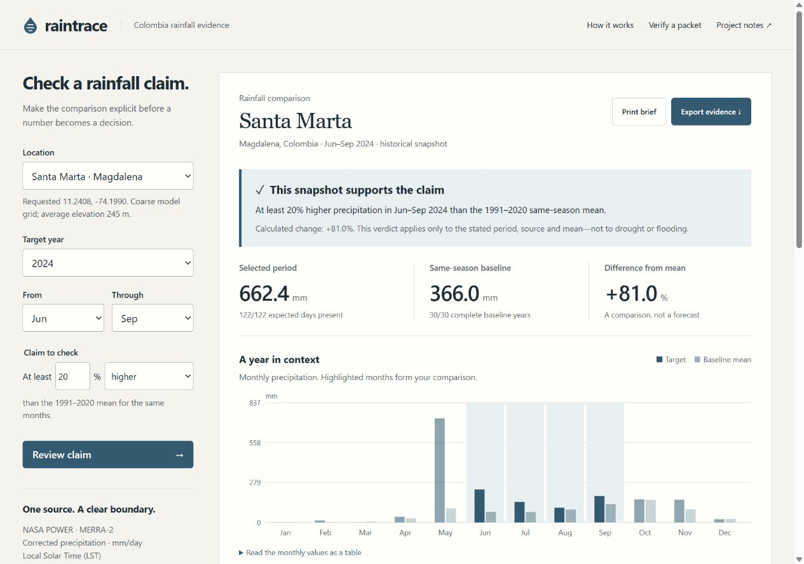

# Raintrace

**A rainfall claim should travel with its evidence.**

Raintrace helps community planners and student environmental researchers in Colombia check a narrowly stated rainfall comparison before citing it in a report. Choose Santa Marta or Bogotá, a year and a season; test a percentage claim against the same months in 1991–2020. Export the original source bytes, calculation settings and reproducible result together.

This is a new educational prototype built on 17 October 2026 (Colombia time) for the **Climate Data & Environmental Monitoring** track of the IEEE ClimateChain Global Hackathon. It is not yet a deployed service or a submitted entry.



## Run locally

Requires Node.js 22 or later. No package installation, credentials or paid service:

```sh
node server.mjs
# Open http://127.0.0.1:4179
node --test tests.mjs
```

For static hosting, serve the project over HTTPS. The browser needs Web Crypto, supported on HTTPS and localhost. Do not open `index.html` as a file URL. The working app needs `index.html`, `style.css`, `app.mjs`, `core.mjs`, `catalog.json`, both location JSON files, `README.md` and `FUENTES.md`. All analysis runs locally in the browser. The server is a development-only static file server bound to localhost. It is not a production multi-tenant backend.

## Try the full workflow

1. Keep Santa Marta, Jun–Sep 2024, at least 20% higher. The pinned source yields 662.4 mm versus a 366.029333 mm baseline mean, a calculated +80.969103% difference.
2. Change **higher** to **lower** and review. The original lower-rainfall claim is not supported; the app does not echo the user's desired conclusion.
3. Open **Try the missing-data safeguard**, remove one day, and observe the abstention and disabled export. This deliberately modified copy is visibly labeled. Restore the original.
4. Export an evidence JSON. Load it in **Verify a shared packet** or run `node verify.mjs path/to/packet.json`.
5. Edit an exported field and retry verification. Byte integrity fails. Even a recalculated packet hash cannot replace the pinned source or invent a non-reproducible result.
6. Download the selected daily CSV, inspect the monthly table, or print the brief. Switch location or year and repeat. The URL preserves the applied settings on reload.

## Why this exists

A screenshot of a climate chart is difficult to audit: its source revision, calendar, baseline, missing days and transformation may be absent. Raintrace combines a narrowly stated claim, strict completeness gate and portable source-to-result evidence packet in one short workflow. The output is usable by the next reviewer without trusting a screenshot or a generated narrative.

Existing tools such as [ClimateSERV](https://climateserv.servirglobal.net/) provide broader geospatial climate exploration and downloads. [NASA POWER](https://power.larc.nasa.gov/) provides the source data and its own access tools. Raintrace is a small complementary prototype focused on reproducible claim handover for two Colombian locations, not a new climate model or a claim to first-of-its-kind climate analytics. It does not replace those tools or local scientific expertise.

## Calculation and boundaries

- Source: NASA POWER `PRECTOTCORR`, MERRA-2, daily mm/day in Local Solar Time. Exact original JSON, query URLs, retrieval timestamps and SHA-256 digests are retained in `catalog.json` and [FUENTES.md](FUENTES.md).
- Baseline: arithmetic mean of 30 complete same-season totals, 1991–2020. Target years: 2021–2025.
- Calendar: February 29 is excluded in every year so equal selected calendar days are compared. This is a documented application choice, not a claim of WMO-standard climatological-normal calculation.
- Sum one daily rate across each day to obtain millimeters for the selected period. Change = `(target − mean) / mean × 100`.
- Any missing, negative or nonnumeric value makes that season incomplete. No imputation or silent removal of a baseline year. Zero baseline blocks a percentage verdict.
- The displayed IQR and range describe baseline variation; they are not a confidence interval or a probability.
- This is coarse-grid model data, about 0.5° × 0.625°, not a station or a municipality-wide average. Grid elevation and coastal/mountain conditions may differ from a chosen city point.
- A comparison does not establish drought, floods, water shortages, trends, climate-change attribution or causality. No measured carbon savings, users or real-world outcome are claimed.

## Integrity and privacy

Evidence verification checks the packet digest, source fingerprint against this release's catalog, metadata, and an independent recalculation using the same documented algorithm. This detects inconsistency with the pinned copy. It is **not** a NASA digital signature, trusted timestamp, blockchain or assurance that the source represents local weather accurately. Someone controlling both application and catalog can replace them; distribute the reviewed release and fingerprints through a trusted channel.

Imported files stay in the browser, capped at 2 MB. They are parsed as JSON, never executed. No telemetry, wallet, accounts, user tracking, browser storage or external runtime requests are used. Source retrieval was done once per location during preparation; normal use reads bundled files only. The optional NASA source link opens NASA when explicitly selected.

## Validation

`tests.mjs` covers arithmetic, leap calendars, threshold boundaries, missing records, invalid units/time standards, zero baseline, source fingerprints, packet tampering and CSV missing-value preservation. `independent-reference.py` computes six real-data reference cases separately using Python `Decimal` and calendar arithmetic. Its saved result is checked by the Node suite. This is an arithmetic cross-check, not independent validation of NASA data or evidence of usability with real planners.

Browser QA, exact results and limitations are recorded in [QA.md](QA.md). Deployment, public repository and the required real 3–5 minute demo remain parent-workflow tasks.

## Files

`core.mjs` is the shared calculation and integrity engine. `app.mjs` and CSS build the browser interface. `verify.mjs` verifies packets outside the UI. `acquire-data.mjs` documents the bounded acquisition. `SUBMISSION.md` contains accurate submission copy. `DEMO.md` is a recording plan, **not a completed video**.

## Authorship and license

Built with substantial AI coding assistance from OpenAI Codex for Jhonatan Del Rio Mejia (EazyHood). The product does not use a generative model at runtime, and no human-only authorship is claimed. No earlier completed project code was reused. Source code is MIT; public source data retains its separate NASA attribution. See [LICENSE](LICENSE) and [FUENTES.md](FUENTES.md).
